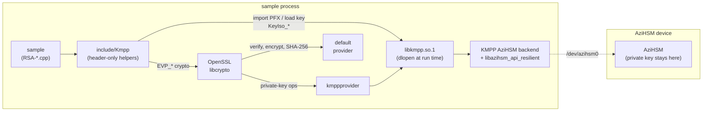
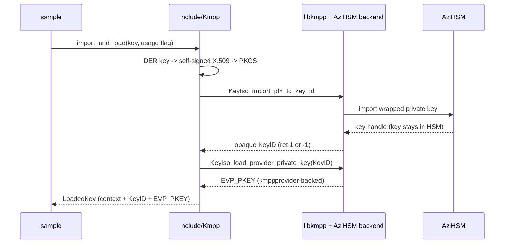

# KMPP × AziHSM — Linux C++ samples (RSA)

[**Azure Integrated HSM**](https://github.com/microsoft/AziHSM-Guest) (**AziHSM**) is a **Hardware
Security Module** (**HSM**) that creates, caches, and uses cryptographic keys inside an isolated
hardware boundary. [**KMPP**](https://github.com/microsoft/KMPP) exposes AziHSM to Linux
applications as an **OpenSSL 3 provider** (`kmppprovider`).

These samples show how a small **C++17** application keeps an RSA private key inside AziHSM through
KMPP, using the plain OpenSSL 3 C API. They are the C++ counterparts of the RSA
[Rust KMPP samples](../../rust/kmpp/README.md): **same scenarios, same embedded test keys, same
import flow, same output**.

Read the [Rust KMPP README](../../rust/kmpp/README.md) too: its **Prerequisites** and
**Constraints** sections apply unchanged to these samples.

## Samples

| Sample | Rust counterpart | Algorithm | What it shows |
| --- | --- | --- | --- |
| [`RSA-ENCRYPT-DECRYPT`](./RSA-ENCRYPT-DECRYPT) | [`rsa-encrypt-decrypt`](../../rust/kmpp/rsa-encrypt-decrypt) | RSA-OAEP (2048 / 3072 / 4096) | Encrypt with the public key (in process), decrypt with the private key inside AziHSM, verify the round-trip. |
| [`RSA-SIGN-VERIFY`](./RSA-SIGN-VERIFY) | [`rsa-sign-verify`](../../rust/kmpp/rsa-sign-verify) | RSA PKCS#1 v1.5 **and** PSS (2048 / 3072 / 4096) | Sign inside AziHSM, verify independently with the public key. |

Each sample is an **independent program** in its own folder (`<NAME>/<NAME>.cpp` + `Makefile` +
`README.md`), sharing only the header-only helpers in [`include/Kmpp`](./include/Kmpp) — the same
layout as the Windows KSP samples in the parent [`cpp`](..) folder. These Linux samples are built
with `make` and are **not** part of `cpp-samples.sln`.

## How it Works



Everything on the host runs inside the sample's own process — there is no KMPP service or IPC hop
for AziHSM keys. The helpers import the embedded key through `libkmpp` and load it back as a
`kmppprovider`-backed `EVP_PKEY`; private-key operations then reach AziHSM, while public-key
operations and SHA-256 stay in OpenSSL's `default` provider.

### Key import

(How an embedded test key gets into AziHSM.)

<details>
<summary>(Click to Expand)</summary>

KMPP imports keys as PKCS#12, so the helpers wrap the embedded DER key in a throwaway self-signed
certificate first (the KMPP analog of the KSP samples' `wrap_rsa_key`). The key is imported with
exactly **one** usage flag — AziHSM rejects the combined default.



</details>

## How it maps to the Rust samples

| Rust (`rust/kmpp/common/src`) | C++ (`cpp/kmpp/include/Kmpp`) | Notes |
| --- | --- | --- |
| `ffi.rs` — `dlopen` shim | `Kmpp.h` — `detail::kmpp_api()` | Same 3 entry points: `KeyIso_import_pfx_to_key_id`, `KeyIso_load_provider_private_key`, `KeyIso_clear_free_string`; `RTLD_NOW \| RTLD_GLOBAL`; loaded once per process. |
| `ProviderCtx` | `ProviderContext` | `OSSL_LIB_CTX` + `default` + `kmppprovider`; providers unloaded before the context is freed. |
| `KeyId` | `KeyId` | Owns the KeyID string; released with `KeyIso_clear_free_string`. |
| `import_key_der` | `import_key_der` | `d2i_AutoPrivateKey` → self-signed X.509 → `PKCS12_create` → KMPP import. |
| `load_provider_private_key` / `public_from_key` | same names | KeyID → provider-backed `EVP_PKEY`; plain public key for verification. |
| `rsa_oaep` | `rsa_oaep_encrypt` / `rsa_oaep_decrypt` | `RSA_PKCS1_OAEP_PADDING`, default (SHA-1) OAEP hash. |
| `digest_sign_sha256` / `digest_verify_sha256` | same names | SHA-256; PSS uses `RSA_PSS_SALTLEN_DIGEST`; no `provider=` query. |
| `testkeys.rs` (`select_rsa`) | `RsaKeys.h` (`select_rsa`) | Byte-identical RSA-2048/3072/4096 DER keys. |
| `util.rs` + each `main.rs` | `SampleUtils.h` | Sample message, `print_hex`, `import_and_load`, `run_sample` (shared `main`). |

The C++ helpers use RAII throughout (`std::unique_ptr` with OpenSSL deleters) and report failures
by throwing `kmpp::Error`, which carries the OpenSSL error queue; `run_sample` turns it into
`error: …` on stderr and exit code 1.

## Prerequisites

Same as the [Rust samples](../../rust/kmpp/README.md#prerequisites), except the build toolchain:
instead of Rust you need a **C++17 compiler** with the **C library headers**, **`make`**,
**OpenSSL 3.0 development libraries** and **`pkg-config`**. On Azure Linux:

```bash
sudo tdnf install -y gcc-c++ glibc-devel kernel-headers binutils make openssl-devel pkgconf
```

`glibc-devel` is easy to miss: without it the build stops at `fatal error: features.h: No such
file or directory`. The KMPP headers are *not* needed — the client is loaded via `dlopen`.

## Build and Test

```bash
cd samples/cpp/kmpp

make           # build every sample (the umbrella Makefile is the analog of the KSP .sln)
make check     # build and run the device-free tests (OpenSSL only; no KMPP, no device)

# ...or build a single sample on its own:
make -C RSA-SIGN-VERIFY
```

Binaries land in each sample's `bin/` folder, e.g. `RSA-SIGN-VERIFY/bin/RSA-SIGN-VERIFY`. OpenSSL is
located with `pkg-config libcrypto`; override with
`make OPENSSL_CFLAGS=-I/opt/openssl/include OPENSSL_LIBS="-L/opt/openssl/lib64 -lcrypto"`.

`make check` covers key selection, decoding every embedded key, the PFX round-trip, and the RSA-OAEP
and sign/verify helpers (including tampered signatures) on software keys. The KMPP import and the
private-key operations inside AziHSM need a device — run the samples for those.

## Run

Both samples take an optional RSA key size — `2048` (default), `3072` or `4096` (`2k`/`3k`/`4k`
also accepted) — and `--help` for the usage line:

```bash
# RSA-OAEP encrypt/decrypt (ENCRYPT-usage RSA key):
sudo ./RSA-ENCRYPT-DECRYPT/bin/RSA-ENCRYPT-DECRYPT
sudo ./RSA-ENCRYPT-DECRYPT/bin/RSA-ENCRYPT-DECRYPT 4096

# RSA sign/verify — PKCS#1 v1.5 and PSS (SIGN-usage RSA key):
sudo ./RSA-SIGN-VERIFY/bin/RSA-SIGN-VERIFY 3072
```

No OpenSSL configuration is needed: the samples create their own OpenSSL library context and load
`default` + `kmppprovider` explicitly, so the system `openssl.cnf` is not involved.

**Optional convenience:** `./run-all.sh` builds everything, runs `make check`, then runs both
samples for every key size, exiting non-zero if anything fails (set `SUDO=` to skip `sudo`). Run it
as `./run-all.sh`, not `sudo ./run-all.sh` — the script `sudo`s each sample itself.

`import ret=1` (or `-1`) is normal, and the `kmpp_enable_by_default not found` log line is
benign — see the Rust README's [Run](../../rust/kmpp/README.md#run) notes and
[Constraints](../../rust/kmpp/README.md#constraints).

## Debug / Logging

### Understand the error printed by a sample

On failure a sample prints one `error: …` line to stderr and exits with code `1`. When the failure
comes from OpenSSL, the indented lines after it are the OpenSSL error queue, which usually names the
exact cause (for example `could not load the shared library` for a missing provider):

| Message | Likely cause |
| --- | --- |
| `could not load libkmpp` | KMPP client not installed, or not on the loader path (`LD_LIBRARY_PATH`). |
| `failed to load 'kmppprovider'` | OpenSSL cannot find the provider — set `OPENSSL_MODULES` to its directory. |
| `KeyIso_import_pfx_to_key_id failed (ret=0 …)` | AziHSM not selected in the KMPP config, no device access, or AziHSM runtime missing. |
| `invalid argument: …` | A helper in `include/Kmpp` was called with a null key or empty buffer. |
| `fatal error: features.h: No such file or directory` (at build time) | C library headers missing — install `glibc-devel` (see [Prerequisites](#prerequisites)). |

### Get KMPP logs

KMPP writes its own diagnostics as `kmpp_log` lines, both to the console and to the system log.
They often explain an import or provider failure in more detail:

```bash
journalctl --since "10 min ago" | grep kmpp_log
```

### Rule out a custom OpenSSL config

The samples do not use the system `openssl.cnf` for KMPP, but the software steps (building the
import bundle, public-key encrypt and verify) run in OpenSSL's default context. If a customized
`openssl.cnf` seems to interfere, rerun with it disabled (`sudo` resets the environment, so pass
the variable through `env`):

```bash
sudo env OPENSSL_CONF=/dev/null ./RSA-SIGN-VERIFY/bin/RSA-SIGN-VERIFY
```

Use this only for diagnosis — never in a production or FIPS deployment.

### Check the shared helpers without a device

`make check` exercises the helpers on software keys, so a failure there points at the build host
(OpenSSL version, compiler) rather than at KMPP or the device.

## Layout

```
cpp/kmpp/
├── Makefile                 # umbrella: make / make check / make clean (the KSP `.sln` analog)
├── common.mk                # shared build rules included by every program's Makefile
├── run-all.sh               # optional smoke test: build + tests + both samples for all sizes
├── include/Kmpp/            # header-only helpers (the KSP `include/` analog) + README.md
│   ├── Kmpp.h               # libkmpp loader, ProviderContext, KeyId, import/load, RSA ops
│   ├── RsaKeys.h            # embedded RSA test keys + select_rsa()
│   └── SampleUtils.h        # sample message, print_hex, import_and_load, run_sample
├── RSA-ENCRYPT-DECRYPT/     # one folder per sample: <NAME>.cpp + Makefile + README.md
├── RSA-SIGN-VERIFY/
└── tests/                   # device-free tests (`make check`)
    ├── KmppTests.cpp
    └── Makefile
```
