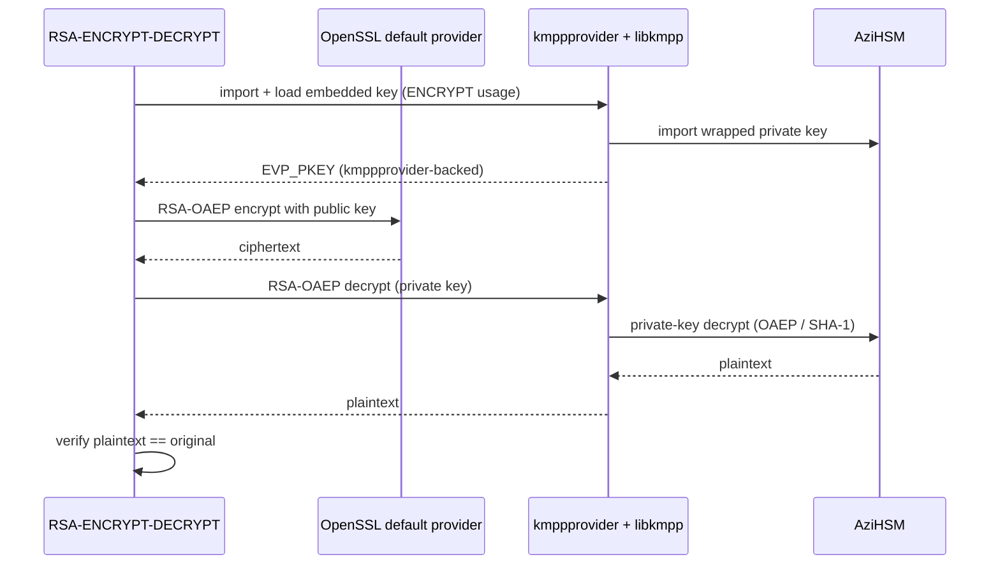

# AziHSM KMPP Sample - RSA-ENCRYPT-DECRYPT

This sample demonstrates AziHSM through KMPP in the following scenario:

1. Import an embedded RSA test key into KMPP with the **ENCRYPT** usage; the private key is
   materialized inside AziHSM.
2. RSA-OAEP encrypt a message with the public key (in process).
3. RSA-OAEP decrypt the ciphertext with the private key, inside AziHSM.
4. Verify that the decrypted message matches the original.

This shows how a Linux application decrypts with a key it never sees. It is the C++ counterpart of
the Rust [`rsa-encrypt-decrypt`](../../../rust/kmpp/rsa-encrypt-decrypt) sample.

## How it works



Encryption is a public-key operation, so it runs **in process on the CPU** and is not offloaded to
the device. Decryption needs the private key, so KMPP routes it to AziHSM. The OAEP hash stays at
the OpenSSL default (SHA-1) — a KMPP-wide constraint, see the Rust README's
[Constraints](../../../rust/kmpp/README.md#constraints).

## How to run

> See the [C++ samples README](../README.md) to build, and the
> [Rust KMPP README](../../../rust/kmpp/README.md#prerequisites) for prerequisites.

The sample accepts a single command-line argument, which chooses the RSA key size: 2k (2048), 3k
(3072) or 4k (4096). Run it in one of the following ways:

```bash
# Provide NO argument to choose RSA 2048 by default:
sudo ./bin/RSA-ENCRYPT-DECRYPT

# To select RSA 2048
sudo ./bin/RSA-ENCRYPT-DECRYPT 2048
sudo ./bin/RSA-ENCRYPT-DECRYPT 2k

# To select RSA 3072
sudo ./bin/RSA-ENCRYPT-DECRYPT 3072
sudo ./bin/RSA-ENCRYPT-DECRYPT 3k

# To select RSA 4096
sudo ./bin/RSA-ENCRYPT-DECRYPT 4096
sudo ./bin/RSA-ENCRYPT-DECRYPT 4k

# Print the usage line:
./bin/RSA-ENCRYPT-DECRYPT --help
```

You should see output similar to this:
> The ciphertext differs on every run (OAEP is randomized), and `import ret` may be `1` or `-1`;
> both mean the key was imported.

<details>
<summary>(Click here)</summary>

```
=== KMPP x AziHSM: RSA-OAEP encrypt -> decrypt ===
[step 1] import + load embedded RSA-2048 test key (ENCRYPT usage)
  imported PFX -> KeyID (isolated in AziHSM); import ret=1
  loaded KeyID via KMPP provider -> EVP_PKEY (2048 bits)
[step 2] encrypt with public key (RSA-OAEP)
  encrypted 33 bytes -> 256 bytes ciphertext
  ciphertext (256 bytes):
    477A9E9060F2791229A62B2A10F140127FA54018B0EC97C21201C7E8CF7EAB08
    ...
    9015255D6C56DC698A200FCC97E0ECC92736AEDDAE9E2C8FC0D78888AF3B899E
[step 3] decrypt with private key -> KMPP -> AziHSM
  decrypted -> 33 bytes
[step 4] verify round-trip

[PASS] RSA-OAEP round-trip verified — private-key op ran inside AziHSM.
```

</details>