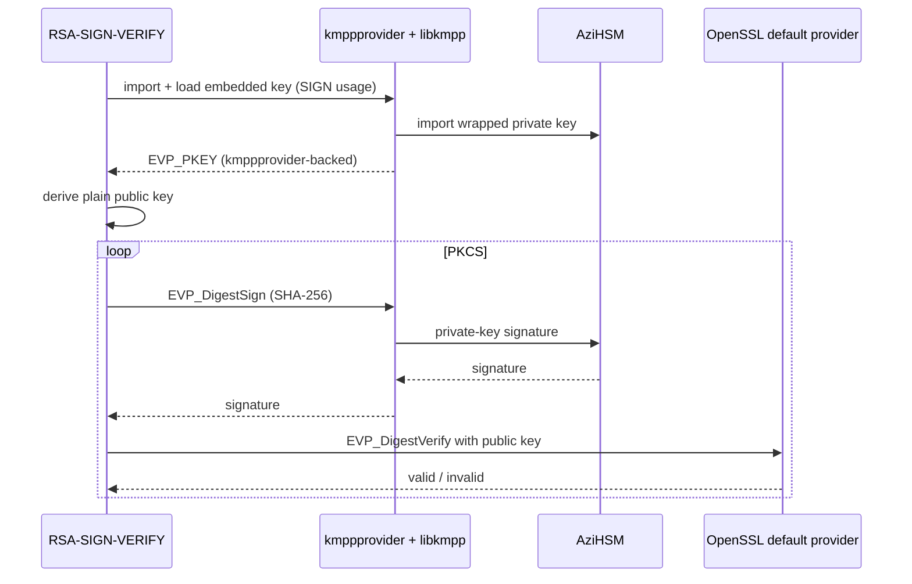

# AziHSM KMPP Sample - RSA-SIGN-VERIFY

This sample demonstrates AziHSM through KMPP in the following scenario:

1. Import an embedded RSA test key into KMPP with the **SIGN** usage; the private key is
   materialized inside AziHSM.
2. Sign a message inside AziHSM with RSA PKCS#1 v1.5, then with RSA-PSS.
3. Verify each signature with the public key only (OpenSSL `default` provider).

This shows how a Linux application signs with a key it never sees. It is the C++ counterpart of the
Rust [`rsa-sign-verify`](../../../rust/kmpp/rsa-sign-verify) sample.

## How it works



Signing is *object-anchored* to the key's provider (no `provider=` query), so it runs on AziHSM
while the SHA-256 digest resolves from OpenSSL's `default` provider. PSS uses salt length == hash
length, which AziHSM enforces. Verification uses only the public key and never touches the device.

## How to run

> See the [C++ samples README](../README.md) to build, and the
> [Rust KMPP README](../../../rust/kmpp/README.md#prerequisites) for prerequisites.

The sample accepts a single command-line argument, which chooses the RSA key size: 2k (2048), 3k
(3072) or 4k (4096). Run it in one of the following ways:

```bash
# Provide NO argument to choose RSA 2048 by default:
sudo ./bin/RSA-SIGN-VERIFY

# To select RSA 2048
sudo ./bin/RSA-SIGN-VERIFY 2048
sudo ./bin/RSA-SIGN-VERIFY 2k

# To select RSA 3072
sudo ./bin/RSA-SIGN-VERIFY 3072
sudo ./bin/RSA-SIGN-VERIFY 3k

# To select RSA 4096
sudo ./bin/RSA-SIGN-VERIFY 4096
sudo ./bin/RSA-SIGN-VERIFY 4k

# Print the usage line:
./bin/RSA-SIGN-VERIFY --help
```

You should see output similar to this:
> The PSS signature differs on every run (PSS is randomized), and `import ret` may be `1` or `-1`;
> both mean the key was imported.

<details>
<summary>(Click here)</summary>

```
=== KMPP x AziHSM: RSA sign -> verify (PKCS#1 v1.5 + PSS) ===
[step 1] import + load embedded RSA-2048 test key (SIGN usage)
  imported PFX -> KeyID (isolated in AziHSM); import ret=1
  loaded KeyID via KMPP provider -> EVP_PKEY (2048 bits)
[sign/verify] RSA PKCS#1 v1.5
  signed 33 bytes -> 256 byte signature
  signature (256 bytes):
    411168190B071C84858D4485AFB927B797ABC2DEDF005EE8B00ECBC1457D2D8F
    ...
    FB62F6A7D48703923EA8B1F58980584E87C589B758E321E3D673003AC97092D3
  verified OK
[sign/verify] RSA-PSS
  signed 33 bytes -> 256 byte signature
  signature (256 bytes):
    6BE619C560443019A966712DA85ACE8CCB7DB506DE6F75B7CCD0B07737CC93E4
    ...
    28CC9BB1D0D33E595AC04851BBB7EDEB44CA283107AFC400BAB7ADB97B725230
  verified OK

[PASS] RSA-2048 sign/verify (PKCS#1 v1.5 + PSS) — signatures produced inside AziHSM.
```

</details>