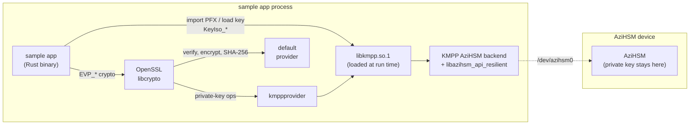
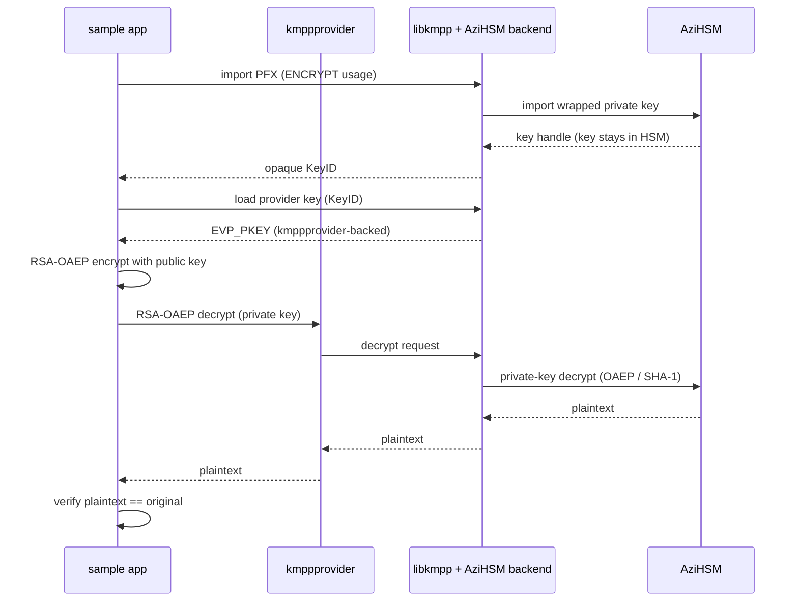
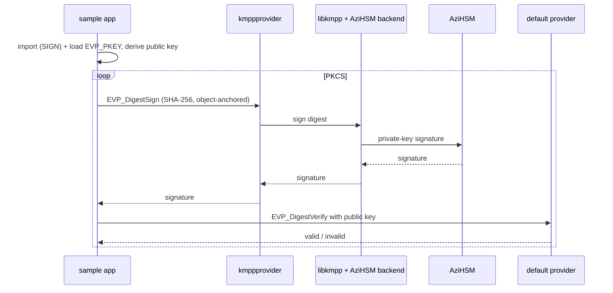
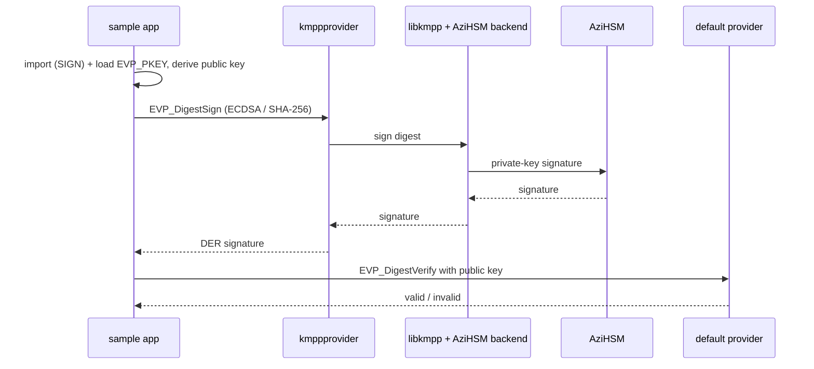

# KMPP × AziHSM — Linux Rust samples

[**Azure Integrated HSM**](https://github.com/microsoft/AziHSM-Guest) (**AziHSM**) is a **Hardware Security Module** (**HSM**) 
that creates, caches, and uses cryptographic keys inside an isolated hardware boundary.
[**KMPP**](https://github.com/microsoft/KMPP) (the Key Management and Protection Platform) exposes
AziHSM to Linux applications as an **OpenSSL 3.0 provider** (`kmppprovider`),
so an ordinary OpenSSL program can keep its private key in the HSM.

These samples show how a small Rust application uses AziHSM **through KMPP**: import a key into KMPP
(where it is materialized **inside AziHSM**), load it back through the provider as an `EVP_PKEY`,
and run one crypto algorithm end to end. Every private-key operation is routed to KMPP → AziHSM;
**the private key never leaves the isolated environment of the AziHSM, and thus is never seen by
the VM nor the application.**

They are the KMPP counterpart of the Windows KSP/CNG C++ samples in [`../../cpp`](../../cpp): those reach
AziHSM through the Windows NCrypt API, while these reach it through KMPP’s OpenSSL provider on Linux.

## Samples

| Sample | Algorithm | What it shows |
| --- | --- | --- |
| [`rsa-encrypt-decrypt`](./rsa-encrypt-decrypt) | RSA-OAEP (2048 / 3072 / 4096) | Encrypt with the public key (in-process), decrypt with the private key inside AziHSM, verify the round-trip. |
| [`rsa-sign-verify`](./rsa-sign-verify) | RSA PKCS#1 v1.5 **and** PSS (2048 / 3072 / 4096) | Sign inside AziHSM, verify independently with the public key. |
| [`ecdsa-sign-verify`](./ecdsa-sign-verify) | ECDSA (P-256 / P-384 / P-521) | Sign inside AziHSM, verify independently with the public key. |

Each sample is an **independent binary** in its own folder (with its own `README.md`); they share
only the `common/` helper library. This mirrors the Windows KSP `cpp` samples' layout.

**C++ versions** of the RSA samples (same scenarios, keys and flow, written against the OpenSSL 3 C
API from C++17) live in [`samples/cpp/kmpp`](../../cpp/kmpp) — see its [README](../../cpp/kmpp/README.md).

## How it Works



Everything on the host runs **inside the sample's own process**: for AziHSM keys there is no KMPP
service or IPC hop. A key is imported into KMPP and loaded back as a provider-backed `EVP_PKEY`;
private-key `EVP_*` calls go `kmppprovider` → `libkmpp` → the AziHSM backend → the device, while
public-key operations and the SHA-256 digest stay in OpenSSL's `default` provider.

### RSA-OAEP encrypt / decrypt

(How `rsa-encrypt-decrypt` encrypts locally and decrypts inside AziHSM.)

<details>
<summary>(Click to Expand)</summary>

The key is imported with the **ENCRYPT** usage. Encryption is a public-key operation the app does
in-process; decryption is the private-key operation that runs inside AziHSM. The OAEP hash and
label are left at their defaults — the KMPP client API does not carry the OAEP digest, so every
backend applies SHA-1 on decrypt (see [Constraints](#constraints)).



</details>

### RSA sign / verify — PKCS#1 v1.5 and PSS

(How `rsa-sign-verify` signs inside AziHSM and verifies with the public key.)

<details>
<summary>(Click to Expand)</summary>

The key is imported with the **SIGN** usage. The sample derives a plain public key (in the
`default` provider) and, for each scheme, signs with `EVP_DigestSign` and verifies independently.
Signing is *object-anchored* to the key’s provider — no `provider=` query — so it runs on AziHSM
while the SHA-256 digest still resolves from the `default` provider. PSS uses salt length == hash
length.



</details>

### ECDSA sign / verify

(How `ecdsa-sign-verify` signs inside AziHSM and verifies with the public key.)

<details>
<summary>(Click to Expand)</summary>

Identical shape to RSA signing, with an EC key (P-256 / P-384 / P-521). The ECDSA signature is
produced inside AziHSM; verification uses the derived public key in the `default` provider.



</details>

## Prerequisites

- **An AziHSM-enabled VM (TVM).** The samples run against real hardware:
  a VM that exposes the AziHSM device (e.g. `/dev/azihsm0`) with the `azihsm` kernel driver
  loaded — see [How To Deploy](../../../docs/HowToDeploy.md). The AziHSM runtime has no in-process
  mock, so the crypto paths need a real device.
- **Linux** (Azure Linux 3 / Mariner or similar). On any other OS the binaries build and parse
  arguments but report that the sample requires Linux.
- **KMPP installed** — the client library `libkmpp.so.1` (loaded at runtime) and the
  `kmppprovider` OpenSSL provider.
- **AziHSM selected as the KMPP isolation solution** —
  `/var/opt/msft/ap/data/kmpp/config.cnf` → `keyiso_solution_type = azihsm`.
- **AziHSM runtime** — `libazihsm_api_resilient.so` present at the path KMPP was built with
  (default `/usr/lib/libazihsm_api_resilient.so.1`), from the `libazihsmr` package.
- **Rust toolchain** (`cargo`), **OpenSSL 3.0 development libraries**, and **`pkg-config`** — the
  samples use the `openssl` crate, whose `openssl-sys` build locates OpenSSL via `pkg-config`
  (e.g. `sudo tdnf install -y gcc openssl-devel pkgconf`). The KMPP headers are *not* needed — the
  client is loaded via `dlopen`.

## Test keys

The samples use **embedded** test keys — bare private keys (DER) baked into the source
([`common/src/testkeys.rs`](./common/src/testkeys.rs)), the Rust analog of the KSP samples'
`RsaKeys.h`. There is nothing to generate and no key file to pass: each sample selects one of its
embedded keys (via an optional size/curve argument — see [Run](#run)), decodes it, mints a
throwaway self-signed certificate over it, packages that as a PKCS#12 in-process
(`kmpp::import_key_der`, the analog of KSP's `wrap_rsa_key`), and imports it into KMPP → AziHSM.
The keys are throwaway and **not** for production use.

## Build

```bash
# Build all samples (the workspace umbrella is the analog of the KSP .sln):
cargo build --release
# binaries: target/release/{rsa-encrypt-decrypt,rsa-sign-verify,ecdsa-sign-verify}

# ...or build a single sample on its own:
cargo build --release -p rsa-sign-verify
```

`libkmpp` is **not** linked — it is `dlopen`ed at runtime, so the crates build without the KMPP
devel package. OpenSSL is provided by the `openssl` crate (its `openssl-sys` build needs the OpenSSL
dev libs + `pkg-config`; see Prerequisites).

## Run

Each sample is an **independent binary** that uses embedded keys and takes an optional argument to
choose the key: the RSA samples take a size (`2048` default, `3072`, `4096`), and
`ecdsa-sign-verify` takes a curve (`p256` default, `p384`, `p521`). Build and run whichever one you
want:

```bash
# RSA-OAEP encrypt/decrypt (ENCRYPT-usage RSA key) — optional size: 2048 (default) | 3072 | 4096:
sudo ./target/release/rsa-encrypt-decrypt
sudo ./target/release/rsa-encrypt-decrypt 4096

# RSA sign/verify — PKCS#1 v1.5 and PSS (SIGN-usage RSA key) — optional size: 2048 | 3072 | 4096:
sudo ./target/release/rsa-sign-verify 3072

# ECDSA sign/verify (SIGN-usage EC key) — optional curve: p256 (default) | p384 | p521:
sudo ./target/release/ecdsa-sign-verify p384
```

To run just one from scratch, build only it and run it — e.g. ECDSA on P-521:

```bash
cargo build --release -p ecdsa-sign-verify
sudo ./target/release/ecdsa-sign-verify p521
```

**Optional convenience:** `./run-all.sh` builds and runs all three, exiting non-zero if any fails
(honors `CARGO_TARGET_DIR`; set `SUDO=` to skip `sudo`). It is just a smoke-test wrapper — not
required to use the samples. Run it as `./run-all.sh`, **not** `sudo ./run-all.sh`: the script
`sudo`s each binary itself, so prefixing the whole script with `sudo` runs `cargo` as root (which
usually has no `cargo` on its `PATH` and does not see your `CARGO_TARGET_DIR`).

Example output (`rsa-encrypt-decrypt`):

```
=== KMPP x AziHSM: RSA-OAEP encrypt -> decrypt ===
[step 1] import + load embedded RSA test key (ENCRYPT usage)
  imported PFX -> KeyID (isolated in AziHSM); import ret=1
  loaded KeyID via KMPP provider -> EVP_PKEY (2048 bits)
[step 2] encrypt with public key (RSA-OAEP)
  encrypted 33 bytes -> 256 bytes ciphertext
  ciphertext (256 bytes):
    ...
[step 3] decrypt with private key -> KMPP -> AziHSM
  decrypted -> 33 bytes
[step 4] verify round-trip

[PASS] RSA-OAEP round-trip verified — private-key op ran inside AziHSM.
```

Notes on the run command:

- Please see the Linux installation instructions to enable non-root access to /dev/azihsm0
  to it and drop `sudo` (`ls -l /dev/azihsm0`).
- **`sudo env VAR=… cmd`**, not `VAR=… sudo` or `sudo -E` — `sudo` resets the environment, so a
  leading `VAR=…` is dropped and `sudo -E` fails under a hardened sudoers policy.
- **No OpenSSL configuration needed.** The samples create their own OpenSSL library context and
  load `default` + `kmppprovider` explicitly, so they do not depend on the system `openssl.cnf`.
  If a customized `openssl.cnf` seems to interfere, rerun with `sudo env OPENSSL_CONF=/dev/null …`
  to ignore it — for diagnosis only, **never** in a production/FIPS deployment.
- **Benign KMPP log lines.** At startup you may see
  `kmpp_log [error] … kmpp_enable_by_default not found in config file …`. That is KMPP's client
  init reading the optional default-provider gate, which these samples do not set (they load
  `kmppprovider` explicitly). It is harmless — the operation still runs; only the `[PASS]` line and
  `exit=0` indicate success.

## Constraints

**Read this before adapting the samples.**

- **Single process.** An AziHSM key exists only in the process that created it (the handle is
  process-local). Import **and** use the key in the same process — exactly what these samples do.
  Discrete `openssl` CLI calls (`genpkey` then a separate `pkeyutl`) cannot share an AziHSM key.
- **Single key usage.** AziHSM rejects the combined (default) key usage, so each sample imports
  with exactly one flag: `KEYISO_KEY_USAGE_ENCRYPT_FLAG` (RSA-OAEP) or `KEYISO_KEY_USAGE_SIGN_FLAG`
  (RSA/ECDSA sign). This is also good practice (single-purpose keys, NIST SP 800-57).
- **RSA-OAEP hash is SHA-1.** The KMPP client API does not carry the OAEP digest across its
  boundary; every backend applies SHA-1 on decrypt. The samples therefore leave the OAEP hash and
  label at their defaults on both encrypt and decrypt. SHA-1 here is a KMPP-wide constraint, **not**
  a security recommendation — it is not FIPS-approved for KTS-OAEP; treat RSA-OAEP decrypt as
  validation-only where compliance is required.
- **RSA-PSS salt = hash length.** The samples set `RSA_PSS_SALTLEN_DIGEST`, which is what AziHSM
  enforces (FIPS 186-5 §5.4(g)).
- **Signing is object-anchored — no mandatory `provider=` query.** The loaded key already belongs
  to `kmppprovider`, so `EVP_DigestSign*` dispatches to AziHSM without a property query. Passing
  a *mandatory* `provider=kmppprovider` query would also force the SHA-256 **digest** fetch into
  KMPP (which registers no digest) and fail on hardware, so the samples pass no query and let the
  digest resolve from the `default` provider.
- **Import `ret` is `1` or `-1`.** `1` = imported + chain validated; `-1` = imported, chain warning
  (the embedded cert is self-signed) — the KeyID is still fully usable. Only `ret == 0` / a null
  KeyID is a real failure.

## Cross-platform / CI

The KMPP/OpenSSL code is gated behind `cfg(target_os = "linux")`, and the `openssl` dependency is
Linux-only, so the crate still **builds on any host** — off-Linux it compiles the samples' "requires
Linux" stubs with no OpenSSL needed. The Linux crypto path is built and exercised **on the device**
(it can't be cross-compiled from another OS, because `openssl-sys` needs a matching OpenSSL).

The embedded test keys have a platform-independent sanity test (`cargo test`); the crypto paths
require a device and are exercised by running the samples.

## Layout

```
rust/kmpp/
├── Cargo.toml               # workspace umbrella (builds all — the KSP `.sln` analog)
├── run-all.sh               # optional smoke test: build + run all three
├── common/                  # shared helper library (the KSP `include/` analog)
│   ├── Cargo.toml           # openssl + openssl-sys + foreign-types + libc (Linux only)
│   └── src/
│       ├── lib.rs
│       ├── ffi.rs           # thin libkmpp dlopen shim: the 3 KeyIso_* entry points (Linux)
│       ├── kmpp.rs          # openssl-crate wrappers: provider ctx, import_key_der, load, crypto (Linux)
│       ├── testkeys.rs      # embedded raw test keys (the KSP `RsaKeys.h` analog)
│       └── util.rs          # print helpers
├── rsa-encrypt-decrypt/     # one folder per sample: Cargo.toml + README.md + src/main.rs
│   ├── Cargo.toml
│   ├── README.md
│   └── src/main.rs
├── rsa-sign-verify/
│   ├── Cargo.toml
│   ├── README.md
│   └── src/main.rs
└── ecdsa-sign-verify/
    ├── Cargo.toml
    ├── README.md
    └── src/main.rs
```

## Learning Resources

* [AziHSM-Guest](../../../README.md) and its [docs](../../../docs) — deploying and installing AziHSM.
* [Windows KSP/CNG C++ samples](../../cpp) — the same crypto scenarios through the NCrypt API.
* [KMPP C++ samples](../../cpp/kmpp) — the RSA scenarios above, in C++17 over the OpenSSL 3 C API.
* [OpenSSL provider concepts](https://docs.openssl.org/master/man7/provider/) — how OpenSSL 3.0
  routes operations to providers such as `kmppprovider`.
